# Como começar a usar o UOS|learn-basic-operations|

## I. Primeiros Passos

A Área de Trabalho do UOS oferece o mesmo modo de layout de tela inicial que o Windows — o Modo Eficiente. Se você deseja ter um efeito visual mais moderno, pode optar pelo Modo Elegante.

**Esquema do layout da área de trabalho:**

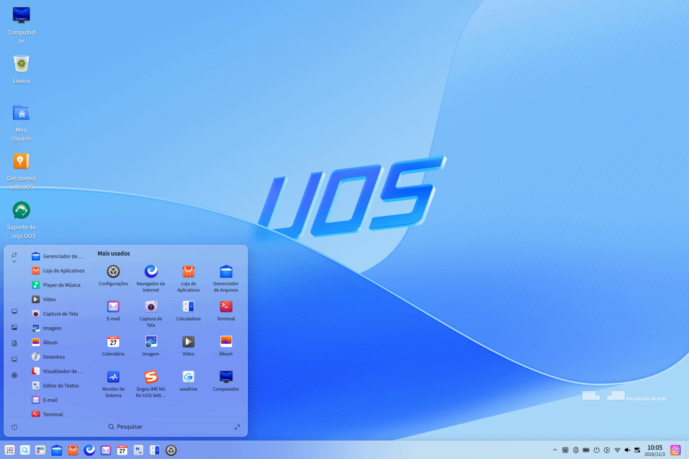

### 1. Iniciador (Iniciar)

Usuários familiarizados com o Windows sabem que qualquer função começa pelo menu Iniciar, como localizar ou abrir aplicativos. No UOS, há um menu inicial (Iniciador) similar ao do Windows, onde você pode realizar as mesmas operações que no menu Iniciar do Windows. Para obter mais informações sobre o uso do Iniciador, consulte **Manual - Ambiente da Área de Trabalho - Iniciador** ou pressione a tecla "F1" para abrir o Manual.

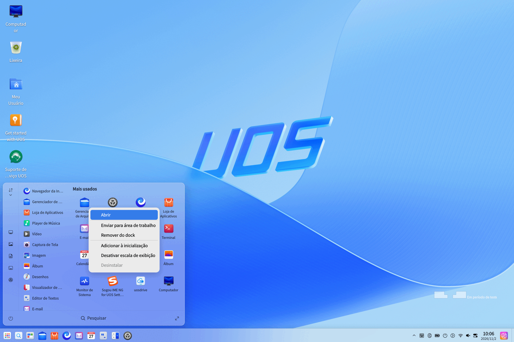

### 2. Dock

Assim como a Barra de Tarefas no Windows, o Dock do UOS é dividido em várias áreas, como Inicialização Rápida, Bandeja do Sistema, Área de Plug-ins, entre outras. A barra de inicialização rápida permite fixar seus aplicativos mais utilizados para abri-los facilmente com um clique.

A área da Bandeja permite ajustar atalhos de Bluetooth, rede e outras configurações diretamente. Você também pode gerenciar a bandeja arrastando os ícones para organizá-los na janela da bandeja.

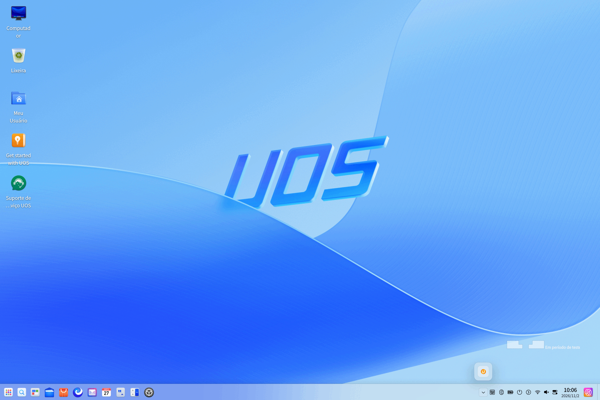

A Área de Plug-ins exibe ações frequentes e pode ser personalizada em Centro de Controle > Personalização > Dock. Plug-ins comumente utilizados, como captura e gravação de tela, monitor do sistema e pesquisa global, podem ficar fixados; alguns plug-ins também podem ser arrastados para o painel de atalhos para gerenciamento, proporcionando beleza e praticidade.

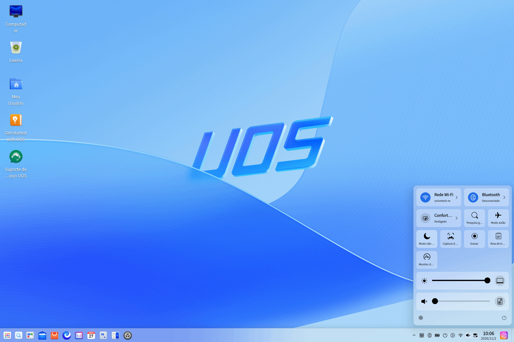

### 3. Computador (Este Computador)

**Computador no UOS**

Assim como o Explorador de Arquivos do Windows, o Gerenciador de Arquivos do UOS gerencia arquivos e a Área de Trabalho. Por padrão, a Área de Trabalho exibe "Computador" , equivalente a "Este Computador" no Windows.

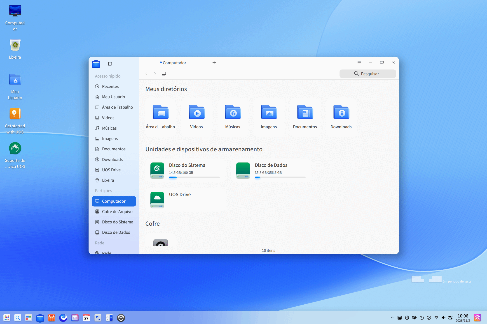

**Configurar acesso rápido a pastas frequentes**

Você pode ajustar a barra lateral e arrastar e soltar para reorganizar as pastas frequentes. Ou pode fixar pastas que precisa acessar a qualquer momento na barra lateral de navegação selecionando "Fixar no acesso rápido" no menu de contexto (botão direito). Isso permite personalizar o gerenciador de arquivos de acordo com seus hábitos.

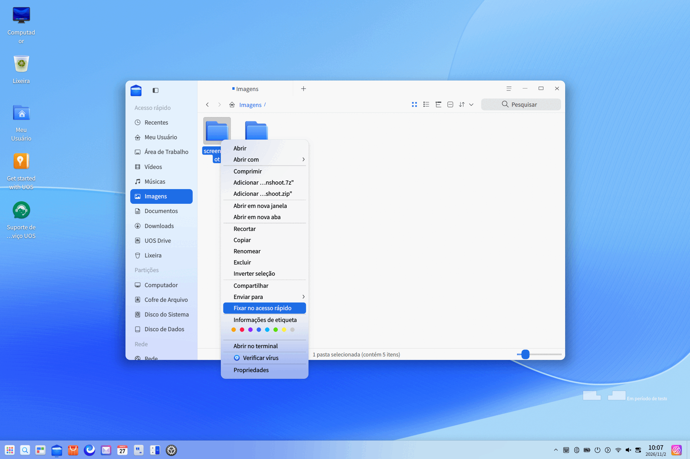

**Menu de contexto prático**

Funções frequentes, como imprimir arquivos, compactar arquivos e enviar arquivos rapidamente, podem ser acessadas no menu do botão direito do arquivo.

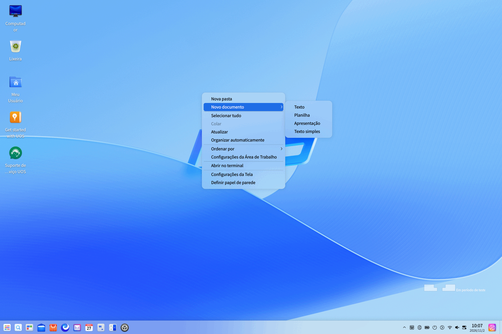

Mais detalhes sobre o uso do gerenciador de arquivos podem ser consultados em **Manual - Gerenciador de Arquivos**, ou [clique no link](https://www.bilibili.com/video/BV1dT411574j/?share_source=copy_web&vd_source=76cf82177880a7aa76195eee437b80a6) para assistir ao vídeo.

### 4. Loja de Aplicativos

O UOS não pode executar diretamente instaladores no formato do Windows (.exe) baixados da Internet, mas oferece um canal seguro e completo para download de aplicativos — a **Loja de Aplicativos** .

Você pode baixar e instalar diferentes versões do WPS, WeChat, DingTalk, métodos de entrada e outros aplicativos necessários para o ambiente corporativo. Recomenda-se escolher diretamente os aplicativos com a marcação "Recomendado" para instalação.

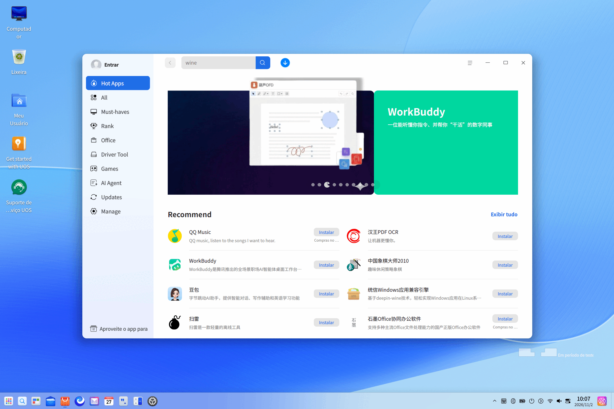

## II. Funções Comuns de Escritório

### 1. Gerenciamento de janelas

**Divisão de tela de aplicativos**

Quando você precisar visualizar o conteúdo de duas janelas de aplicativos simultaneamente, pode acionar a operação de divisão de tela arrastando o aplicativo até a borda esquerda ou direita da tela, aumentando sua eficiência de trabalho.

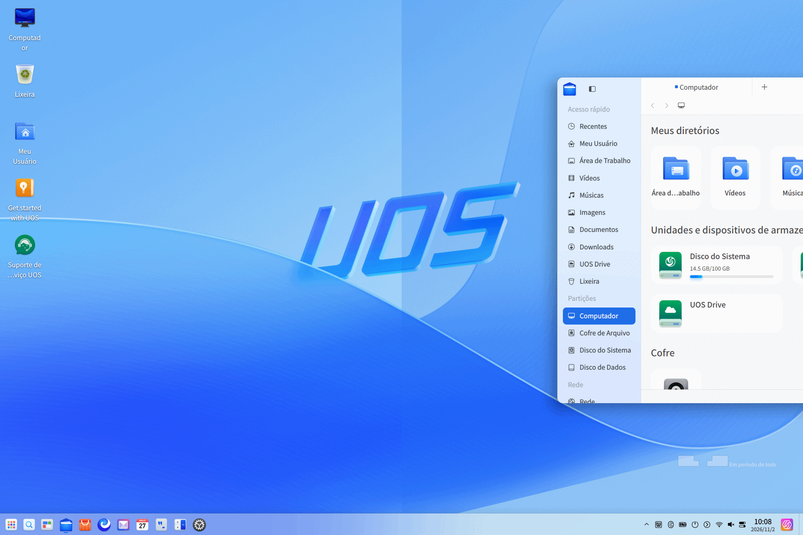

**Alternando janelas**

Ao usar o atalho "Alt+Tab", você pode alternar rapidamente entre várias janelas de aplicativos e localizar os aplicativos abertos, assim como no Windows.

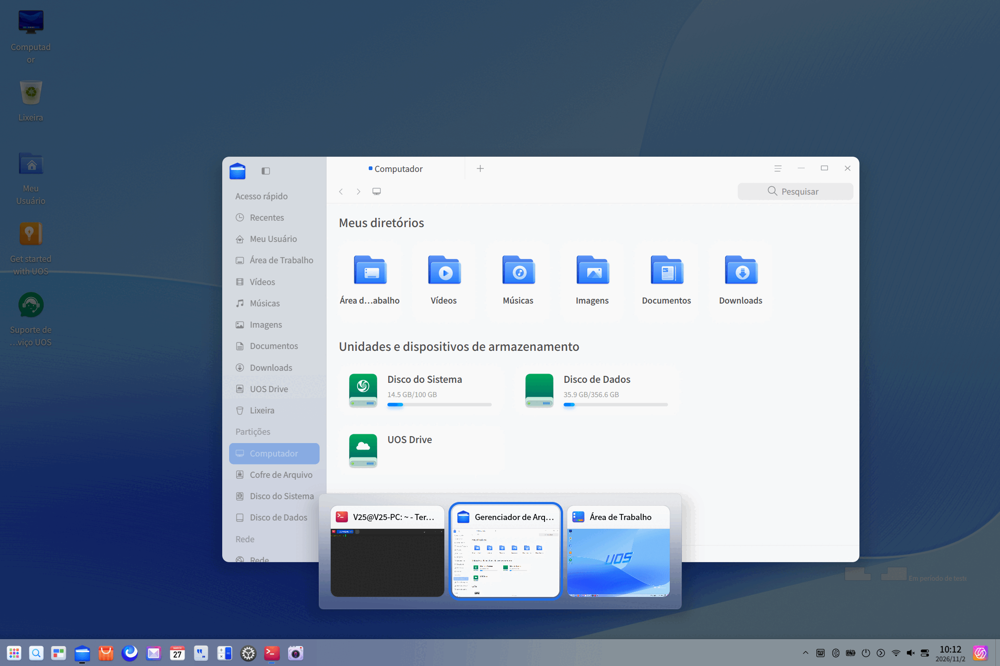

**Visualizar todas as janelas**

Caso tenha muitas janelas abertas, você pode clicar no ícone  no Dock para abrir a "Visualização de Multitarefa", ou usar o atalho de teclado "Super (tecla com o logotipo do Win) + S" em conjunto com o mouse para selecionar qualquer janela de aplicativo para alternar.

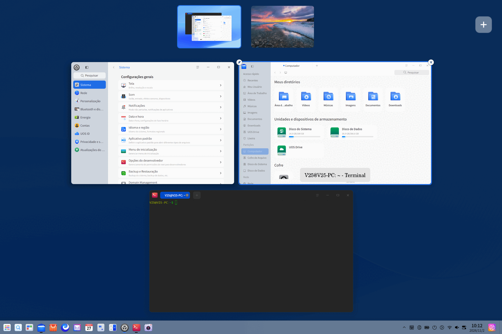

### 2. Extrair texto de capturas de tela

Ao encontrar um texto em uma imagem ou em uma página da web que não permite cópia, você pode usar a ferramenta de captura e gravação de tela integrada do sistema para capturar a área desejada e, na barra de ferramentas, clicar no ícone  para extrair o texto da captura. Em seguida, você pode copiá-lo para outro local ou salvá-lo no computador para compartilhar com outras pessoas.

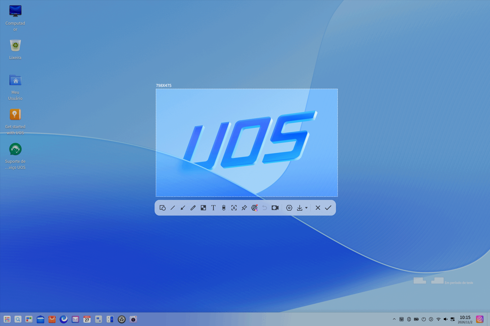

### 3. Conheça mais atalhos de teclado

**Atalhos do sistema**

|             Copiar             |            Recortar            |             Colar              |
| :----------------------------: | :----------------------------: | :----------------------------: |
|             Ctrl+C             |             Ctrl+X             |             Ctrl+V             |
|          **Desfazer**          |          **Imprimir**          |       **Fechar Janela**        |
|             Ctrl+Z             |             Ctrl+P             |             Alt+W              |
|      **Alternar janelas**      |      **Pesquisa global**       |      **Bloquear tela**         |
|            Alt+Tab             |          Shift+Espaço          |          Super(win)+L          |
| **Alternar modo de exibição**  |    **Reconhecimento OCR**      |   **Captura com rolagem**      |
|          Super(win)+P          |           Ctrl+Alt+C           |           Ctrl+Alt+I           |
|      **Captura de tela**       |       **Gravação de tela**     |     **Tela de desligamento**   |
|           Ctrl+Alt+A           |           Ctrl+Alt+R           |        Ctrl+Alt+Delete         |

Nota: O UOS é totalmente compatível com as teclas do Windows, denominando-as como "Teclas Super".

**Atalhos de aplicativos**

| Navegador                          |                                |
| ---------------------------------- | -----------------------------: |
| Reabrir guias fechadas             |                   Ctrl+Shift+T |
| Alternar para a próxima guia       |      Ctrl+Tab ou Ctrl+PageDown |
| Alternar para a guia anterior      |  Ctrl+Shift+Tab ou Ctrl+PageUp |
| Fechar a guia atual                |              Ctrl+W ou Ctrl+F4 |
| **Métodos de Entrada**             |                                |
| Alternar método de entrada         |                     Ctrl+Shift |
| Ativar/desativar método de entrada |                    Ctrl+Espaço |
| Alternar entre idiomas             |                          Shift |

Use o atalho de teclado "Ctrl + Shift + /" dentro da janela do aplicativo para visualizar mais atalhos disponíveis.

## III. Personalizando sua Área de Trabalho

À medida que você se familiariza com o UOS, que tal personalizar seu ambiente de trabalho? Comece pelas configurações de papel de parede.

### 1. Configurações de papel de parede e descanso de tela

**Definir papel de parede:** Clique com o botão direito na área de trabalho e selecione "Definir Papel de Parede" para escolher seu papel de parede favorito na parte inferior da tela, ou personalize usando suas próprias fotos. Para mais opções de papéis de parede personalizados, acesse a Loja de Aplicativos e pesquise por temas para download.

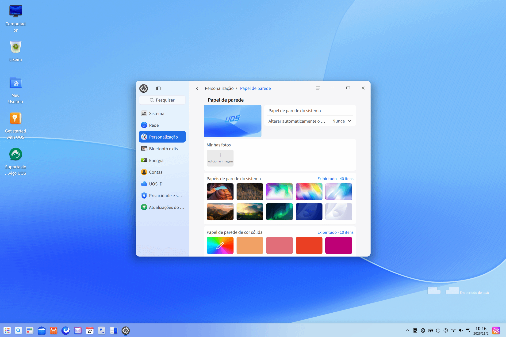

**Configurações do descanso de tela:** No mesmo menu das configurações de papel de parede, clique em "Descanso de Tela". Você também pode clicar em "Personalizar Descanso de Tela" para definir uma rotação de imagens como descanso de tela; na janela pop-up de configuração, é possível ajustar o intervalo de transição e a rotação aleatória.

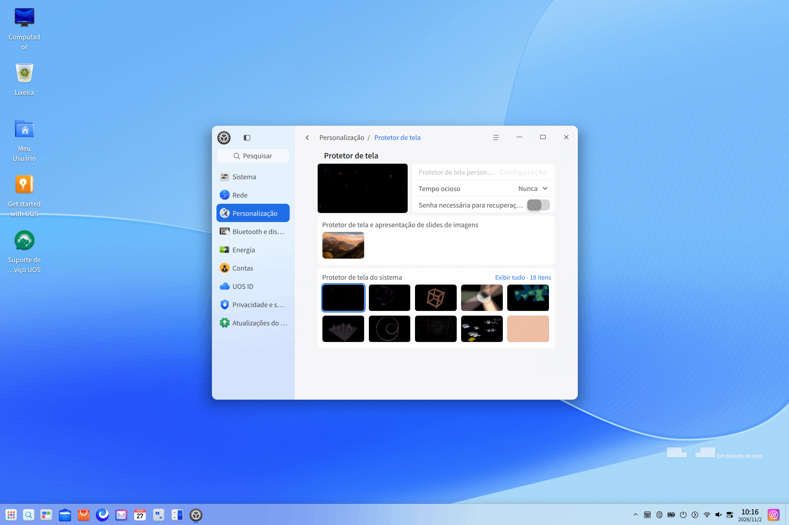

O Centro de Controle também oferece mais recursos de personalização, que podem ser explorados em Centro de Controle > Personalização.

### 2. Configuração de tela externa

Ao utilizar o modo estendido, se precisar ajustar a disposição dos monitores, acesse Centro de Controle > Sistema > Tela. Utilize o mouse para **arrastar** as miniaturas das telas e ajustar suas posições relativas, correspondendo à disposição física real dos dois monitores para uma melhor experiência de uso.

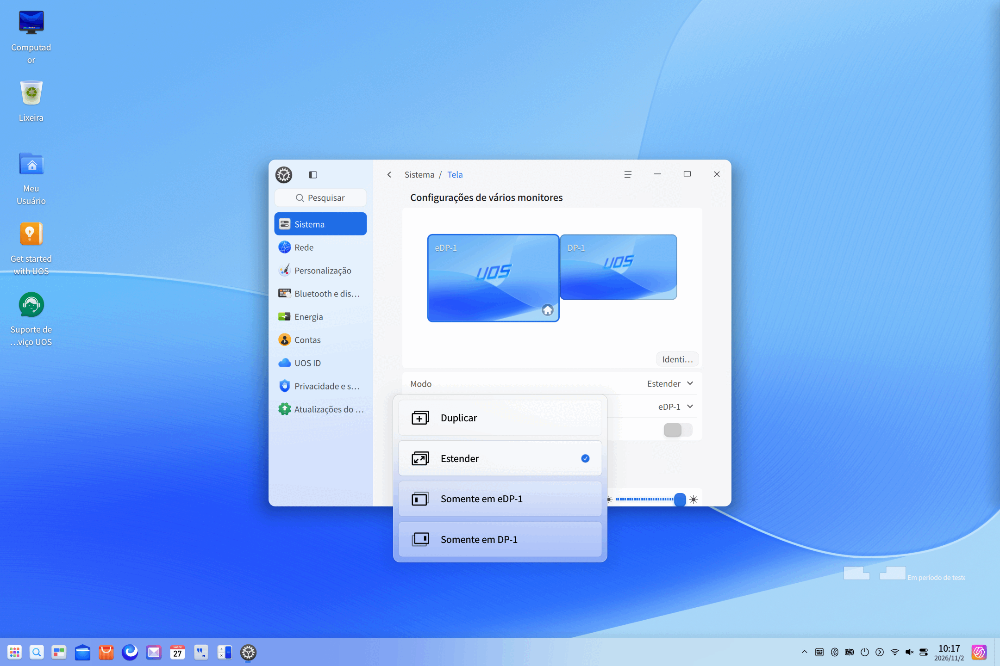

## IV. Perguntas Frequentes

Para mais perguntas e respostas, visite as [Perguntas Frequentes (FAQ)](https://faq.uniontech.com/)

### 1. Como limpar o sistema

A função "Limpeza" do Centro de Segurança permite remover arquivos e dados desnecessários para liberar espaço em disco. Abra o Centro de Segurança, marque os tipos de dados que deseja limpar, clique em "Verificar Agora" para escanear arquivos temporários e indesejados, selecione o que deseja remover e clique em "Limpar Agora", de forma rápida e intuitiva.

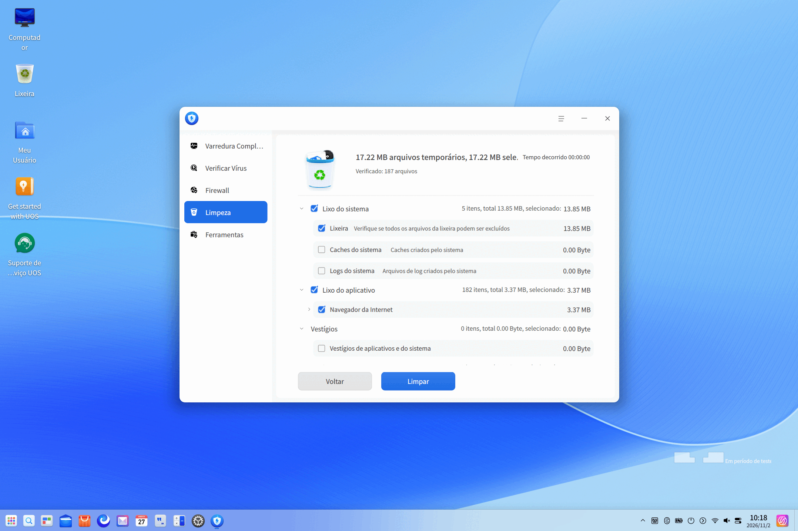

### 2. Como monitorar o status do sistema

Durante a execução do sistema, um aplicativo pode consumir recursos excessivos e causar lentidão. Nesse caso, você pode abrir o Monitor do Sistema para encerrar o processo do aplicativo que estiver consumindo muitos recursos e não estiver em uso, garantindo o desempenho e a estabilidade do sistema.

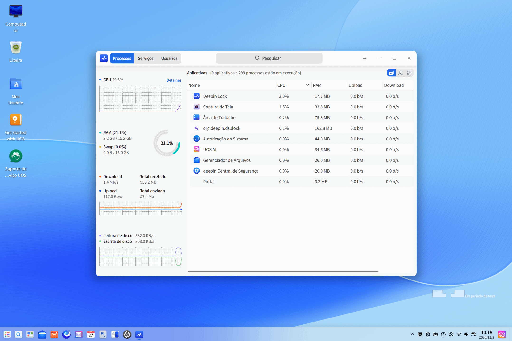

### 3. Como conectar uma impressora

Na interface do Gerenciador de Impressoras, clique no botão Adicionar para entrar na interface de adição de impressoras. O aplicativo identificará e listará automaticamente as impressoras compartilhadas encontradas na rede local. Após selecionar a impressora, o aplicativo recomendará automaticamente o driver mais adequado; clique em Instalar para concluir a configuração. Você também pode pesquisar impressoras na rede local manualmente ou inserindo a URI correspondente.

Para outros métodos de adição de impressoras, consulte **Manual - Gerenciador de Impressoras**.

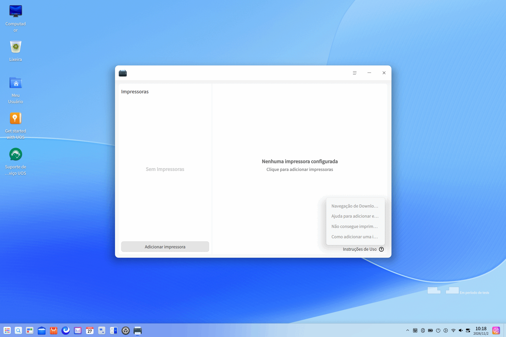

### 4. Como se conectar à rede

Se você não conseguir abrir páginas da web no navegador, verifique se a conexão com ou sem fio está ativa. Você pode clicar no ícone de Wi-Fi na bandeja do Dock , selecionar o nome da rede sem fio desejada e inserir a senha, ou conectar um cabo de rede para usar uma conexão cabeada.

Geralmente, o acesso à rede corporativa possui seu próprio método de autenticação de segurança. Se você precisar configurar a autenticação de segurança de rede, acesse Centro de Controle > Rede e defina a rede cabeada ou sem fio conforme necessário. Para saber mais, [clique no link](https://www.bilibili.com/video/BV1ZT41157dp/?share_source=copy_web&vd_source=76cf82177880a7aa76195eee437b80a6) para assistir ao vídeo.

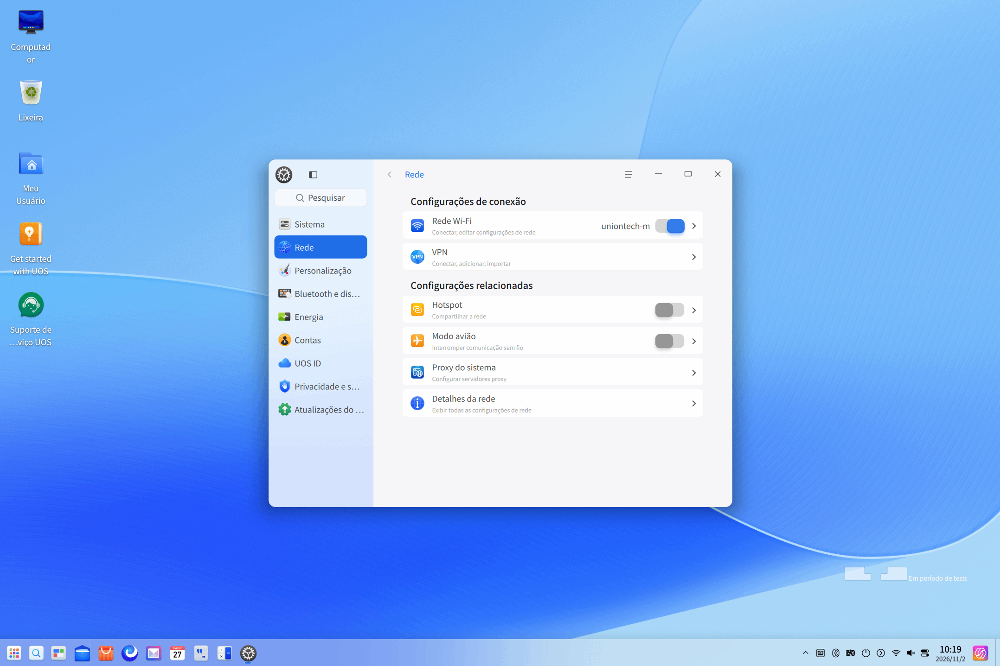

### 5. Como ajustar o método de entrada

Em Centro de Controle > Teclado e Idioma > Configurações de Método de Entrada, clique no botão Editar para selecionar o método de entrada que deseja remover ou arraste para ajustar a ordem de prioridade dos métodos. Se remover um método por engano, basta clicar no botão Adicionar, selecionar o método de entrada desejado e confirmar a adição para restaurá-lo facilmente.

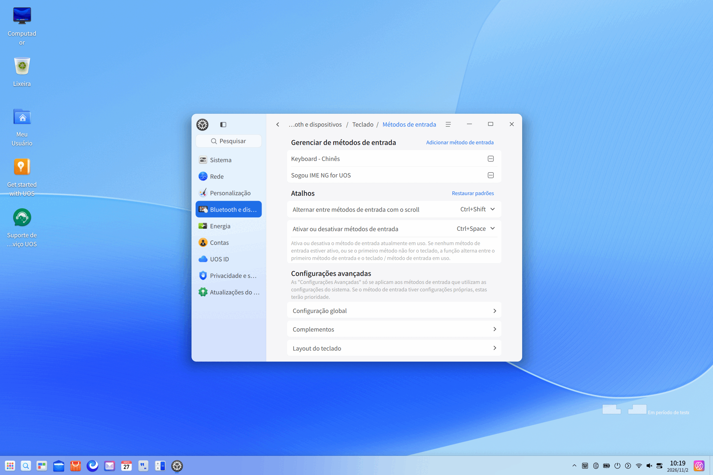
